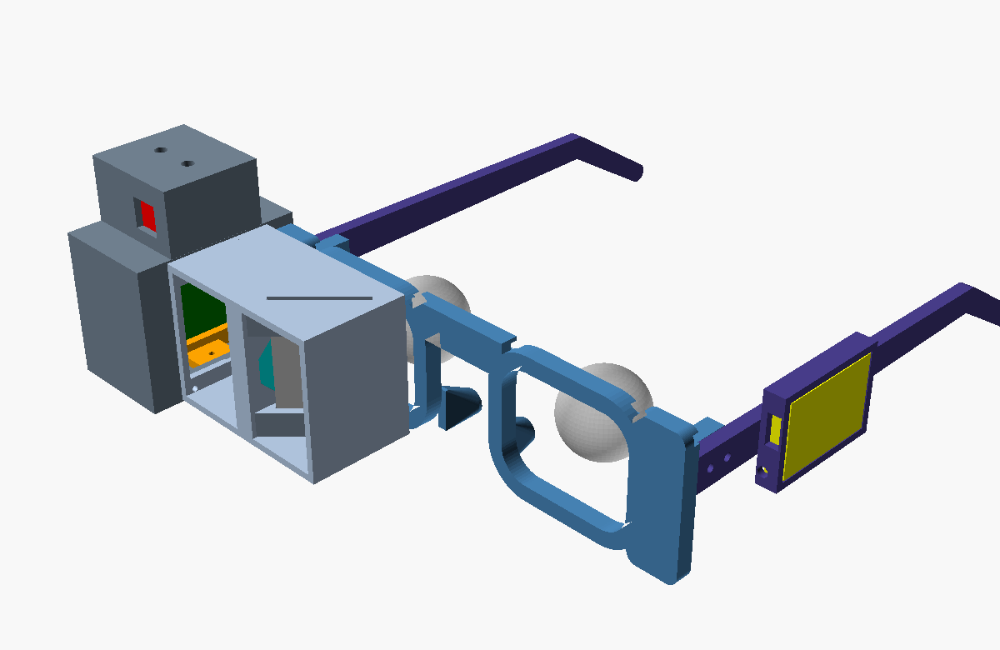

# DIY AR glasses

Glasses you print and wire yourself. They show the edits on the world in front of your right eye,
camera and voice included, using the same laptop pipeline as the Ray-Ban Display route.



```
XIAO ESP32S3 Sense (camera + mic + Wi-Fi) --frames, voice--> laptop: npm run dev (relay :8788)
128x128 OLED --> lens --> 45 degree beam splitter --> right eye  <--overlay-- relay
MPU-6050 gyro: keeps the overlay on the object as your head turns
SELECT button: hold and talk ("make it pink"); UNDO button: undo, hold for "done"
```

How the picture gets to your eye: the OLED sits in the box outboard of the right eye, facing the
nose. Its light goes through the lens, hits the beam splitter (a partly mirrored plate at 45 degrees
in front of your eye) and bounces into your eye, while the world shows through the plate. The lens
makes the tiny screen look about a meter away. Black pixels on an OLED emit nothing, so only the
edit is visible, floating over the real object, like on the Ray-Ban Display.

## Parts to buy (about $50-70)

| Part | Notes | About |
|---|---|---|
| Seeed Studio XIAO ESP32S3 **Sense** | camera, microphone, Wi-Fi, LiPo charger in one; the Sense kit includes the OV2640 camera | $14 |
| 1.5" 128x128 **color OLED**, SSD1351, SPI | e.g. Waveshare 1.5inch RGB OLED or Adafruit 1.5" color OLED. Must be OLED (an LCD's black still glows) | $18-25 |
| MPU-6050 breakout (GY-521) | gyro for head motion | $3 |
| Biconvex lens, 25 mm diameter, ~45 mm focal length | a Google Cardboard lens works | $3-5 |
| Beam splitter plate, ~25 x 25 mm, ~1 mm | 30R/70T or 50/50 glass or acrylic ("beam splitter plate", "teleprompter glass"). In a pinch, a piece of clear acrylic works dimly indoors | $5-15 |
| LiPo 3.7 V, 502030 (~250 mAh) | with protection board | $5 |
| Slide switch SS12D00 | battery on/off | $1 |
| 2x tactile button, 6x6 mm | SELECT, UNDO | $1 |
| M2 screws, 6-8 mm, about 12 | self-tap into the printed parts | $3 |
| Thin wire (30 AWG silicone or wire-wrap), heat shrink | | |

Tools: soldering iron, superglue or hot glue, small screwdriver.

## Print (UT makerspace)

Every STL in [stl/](stl) is already laid in its print orientation: no supports needed.

| File | Qty | Notes |
|---|---|---|
| frame_front.stl | 1 | front face down; 142 mm long |
| temple_left.stl, temple_right.stl | 1 each | left has the battery pod |
| lens_housing.stl | 1 | in front of the right eye |
| display_box.stl | 1 | display + electronics pod |
| display_carrier.stl | 1 | holds the OLED |
| end_cap.stl | 1 | closes the box (USB-C opening) |
| lens_ring.stl, light_shield.stl, battery_lid.stl | 1 each | small flat parts |

Settings: PLA or PETG, 0.2 mm layers, 3 walls, 20-30% infill. **Black or dark filament** for the
lens housing and display box (stray light from a white part washes out the picture).

Before printing, check the lines marked **MEASURE** in [scad/params.scad](scad/params.scad) against
your own head and parts: pupil distance (`ipd`), head width (`frame_half_w`), frame-to-ear length
(`temple_len`), the OLED module's board size and visible area, lens and splitter sizes, the battery,
and the XIAO stack height. Then regenerate the STLs with OpenSCAD:

```bash
./export.sh
```

Do a test print of `lens_housing.stl` first: the splitter slot, lens seat and screw holes tell you
whether `clear` (fit clearance) suits that printer.

## Wire

| XIAO pin | To |
|---|---|
| D8 (SCK) | OLED CLK |
| D10 (MOSI) | OLED DIN |
| D1 | OLED CS |
| D2 | OLED DC |
| D3 | OLED RST |
| D4 (SDA) | MPU-6050 SDA |
| D5 (SCL) | MPU-6050 SCL |
| D0 | SELECT button, other leg to GND |
| D6 | UNDO button, other leg to GND |
| 3V3, GND | OLED VCC/GND, MPU-6050 VCC/GND |
| BAT+ / BAT- pads (underside) | slide switch, then LiPo + / - |

The battery wires run from the left temple's pod, along the channel on the back of the frame's top
bar, through the hole at its right end, along the top inside the lens housing and into the display
box, then up into the pod. Leave a little slack at each joint.

## Assemble

1. **Temples**: screw each onto the frame's joint block (2x M2 from the outside).
2. **Battery**: switch into the left pod's front wall, LiPo into the pod, wires out toward the
   frame; glue on the battery lid.
3. **Lens housing**: drop the beam splitter into the diagonal slot in the top until it sits in the
   bottom groove (don't touch the faces); a drop of glue at the top. Lens into its seat from the
   outer side, then press in the lens ring. Screw the housing to the frame from behind (3x M2).
   Glue the light shield over the open front between the lens and the outer end.
4. **Display**: tape or hot-glue the OLED face-down onto the display carrier (the visible area
   centered in the window, pins away from the window). Slide the carrier into the display box, the
   tongue toward the lens, and put one M2 screw up through the floor slot into the tongue, loose.
5. **Display box**: screw it to the lens housing's outer flange (4x M2).
6. **Pod**: MPU-6050 flat on the pod floor (any orientation; you'll tell the firmware the axes),
   buttons into the two top holes (glue from inside), XIAO with its USB-C toward the open end, and
   the camera module glued behind the front window, looking out. Wire per the table.
7. **End cap**: press on (it has a lip); a dab of glue once everything works.

## Flash the firmware

1. Arduino IDE 2: add the board package `https://espressif.github.io/arduino-esp32/package_esp32_index.json`
   (Settings > Additional boards manager URLs), install **esp32** (3.x), pick **XIAO_ESP32S3**, and
   set **Tools > PSRAM: OPI PSRAM** and **USB CDC On Boot: Enabled**.
2. Library Manager: **WebSockets** (Markus Sattler), **ArduinoJson** (7.x), **Adafruit SSD1351**,
   **Adafruit GFX**.
3. In [../../firmware/reality-glasses](../../firmware/reality-glasses), copy `config.example.h` to
   `config.h`: your Wi-Fi, and the laptop's IP (`ipconfig getifaddr en0`; phone hotspot if the
   campus Wi-Fi blocks device-to-device traffic).
4. Open `reality-glasses.ino`, upload, open the Serial Monitor (115200). Keep the glasses still for
   the first second (the gyro measures its bias).

The firmware hasn't been compiled yet (it was written without the ESP32 toolchain at hand). If a
line doesn't compile on your core version, the API names to check are in the comments at the top.
`c.sccb_i2c_port` can be deleted if your esp32-camera version doesn't have it.

## Run

1. Laptop: `npm run dev`, open `http://localhost:5180`, Source: **Glasses relay**, Display:
   **Aligned window**. The glasses' camera shows as the video.
2. Glasses: switch on. Look at something, **hold SELECT and say** "make it pink", release. The
   view freezes, the object straight ahead is selected, your voice is transcribed (Muse Voice, so
   `META_API_KEY` in `.env`), and the edit appears over the object in the glasses.
3. **UNDO** undoes; **hold UNDO** (0.8 s) goes back to live.

## Calibrate

- **Focus**: show something (Test pattern on the laptop), loosen the carrier screw, slide the display
  until the picture is sharp while you look at something about a meter away, tighten.
- **Mirror**: if text reads backwards, flip `MIRROR_X` in config.h (or `MIRROR_Y` if upside down).
- **Window**: on the laptop, Display: Aligned window + Test pattern. Adjust cx / cy / size until the
  border you see in the glasses frames the same part of the world as the dashed box on the laptop.
  The camera sits above and outboard of your eye, so this is right at one distance (calibrate at the
  distance you'll use, ~1-2 m).
- **Gyro axes**: hold UNDO while switching on; the Serial Monitor prints the gyro axes. Turn your
  head left: the axis that moves the most goes in `YAW_AXIS` (`YAW_SIGN` -1 if it reads negative).
  Look up: `PITCH_AXIS` / `PITCH_SIGN`.
- **Px per degree**: if the overlay lags behind a head turn, raise `PX_PER_DEG`; if it overshoots,
  lower it. Start at 4.3 (128 px over ~30 degrees).

## Limits

The picture is in one eye, about 25-30 degrees wide, 128x128 px, and adds light to the world: it's a
see-through overlay, so recolor reads as a tint and "remove" can't hide the real object. Indoors it's
clearly visible; in sunlight it washes out. The right side is front-heavy (a camera-and-display boom
like Google Glass); padding the nose pads helps.

## Design notes and assumptions

- Rigid temples (no hinges): fewer parts, and the battery wires don't cross a hinge.
- Display outboard of the eye, folded in by the beam splitter, so nothing sits right in front of
  the eye except the clear plate.
- The camera sits in the pod above the display, about 45 mm outboard of and 30 mm above the eye; the
  laptop's aligned window corrects for it at one distance.
- The relay sends the ESP32 the overlay as raw 128x128 RGB565 over HTTP (the ESP32 WebSocket library
  caps messages at ~15 KB) and takes push-to-talk audio as a WAV, which the laptop transcribes with
  the same `/api/transcribe` route the laptop mic uses.
- The models are parametric OpenSCAD ([scad/](scad)); [scad/assembly.scad](scad/assembly.scad) shows
  everything in place with the bought parts as see-through stand-ins.
